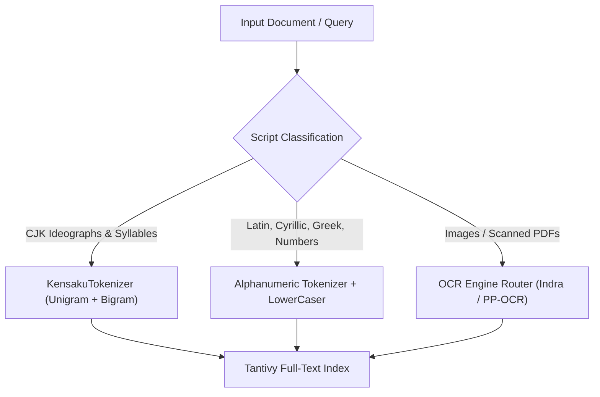

# Multilingual & Language Support in Kensaku

Kensaku is designed from the ground up for **local-first, multilingual search**. Whether searching through codebase repositories in 50+ code and data formats, mixed-script documents (e.g., Japanese/English technical specs), or extracting text from screenshots and scanned invoices across European, Asian, and Middle-Eastern scripts, all processing occurs 100% locally on your machine with zero cloud round-trips.

---

## 1. Natural Languages & Scripts

Kensaku treats human languages and scripts through dedicated tokenization pipelines in Tantivy and local neural network models.



### A. CJK (Chinese, Japanese, Korean)

Standard Western tokenizers split on whitespace and punctuation. Because CJK scripts do not use spaces between words, standard tokenization renders East Asian text unsearchable. 

Kensaku implements a custom CJK tokenizer (`KensakuTokenizer` in `src-tauri/src/indexer/tokenizer.rs`) that performs **character-class segmentation** and generates an **interleaved unigram + bigram token stream** with exact byte-offset tracking.

#### Supported Unicode Blocks

| Script | Unicode Ranges | Description |
|---|---|---|
| **Chinese (Hanzi / 汉字 / 漢字)** | `0x4E00..0x9FFF`<br>`0x3400..0x4DBF`<br>`0x20000..0x2FA1F`<br>`0xF900..0xFAFF` | CJK Unified Ideographs, Extension A, Extensions B–F, and Compatibility Ideographs. |
| **Bopomofo (注音符號)** | `0x3100..0x312F`<br>`0x31A0..0x31BF` | Standard and Extended Bopomofo phonetic symbols. |
| **Japanese (Kanji, Hiragana, Katakana)** | `0x3040..0x309F`<br>`0x30A0..0x30FF`<br>`0x31F0..0x31FF`<br>`0xFF65..0xFF9F` | Hiragana, Katakana, Katakana Phonetic Extensions, and Halfwidth Katakana. |
| **Korean (Hangul / 한글)** | `0xAC00..0xD7AF`<br>`0x1100..0x11FF`<br>`0xFFA0..0xFFDC` | Precomposed Hangul Syllables, Hangul Jamo, and Halfwidth Hangul variants. |

#### Tokenization Mechanics

For a text such as `最終報告書` (Final Report):
1. **Unigrams**: `最`, `終`, `報`, `告`, `書` (guarantees 100% recall on single-character queries).
2. **Bigrams**: `最終`, `終報`, `報告`, `告書` (guarantees high precision for compound words and phrases).
3. **Interleaved Stream**: The token stream preserves exact sequential offsets and relative positions so phrase proximity queries (`near[x]`) operate consistently across East Asian text.

#### Mixed-Script Segmentation

When code or file paths mix CJK with Latin or numbers (e.g. `src/组件/index.ts` or `README最終_v2.md`), Kensaku automatically flushes boundaries between character classes:
* `README最終.md` → `["readme", "最", "最終", "終", "md"]`
* `第12回 Rust勉強会 2026年` → `["第", "12", "回", "rust", "勉", "勉強", "強", "強会", "会", "2026", "年"]`

---

### B. Latin, Cyrillic, Greek & European Languages

* **Boundary Splitting**: Alphanumeric words are segmented on punctuation and non-alphanumeric delimiters (`_`, `-`, `.`, `/`, etc.). Snake_case (`calculate_total_tax`) and kebab-case (`user-auth-token`) identifiers split cleanly into individual searchable terms.
* **Case Folding**: All terms undergo full Unicode lowercasing (`LowerCaser`). Queries are case-insensitive by default.
* **Length Filtering**: Tokens exceeding 40 characters are discarded (`RemoveLongFilter`) to prevent machine hashes or minified hex dumps from bloating the term dictionary.

---

### C. Right-to-Left (RTL) & Indic Scripts

* **Plain Text / Documents**: Native UTF-8 parsing handles Arabic, Hebrew, Persian, Urdu, and Devanagari natively.
* **OCR Text Recognition**: Images containing RTL or Indic scripts are routed through specialized recognizers (see [Section 3](#3-multilingual-ocr-engines)).

---

## 2. Programming, Markup & Configuration Languages

Kensaku indexes source code and structured data files natively. Comments, string literals, and identifiers are searchable in the following formats:

### Supported Languages & Extensions

| Category | Languages | File Extensions / Names |
|---|---|---|
| **Systems & Native** | Rust, C, C++, Go, Swift | `.rs`, `.c`, `.cpp`, `.cc`, `.cxx`, `.h`, `.hpp`, `.go`, `.swift` |
| **Web & Scripting** | TypeScript, JavaScript, Python, Ruby, PHP, Lua, R | `.ts`, `.tsx`, `.js`, `.jsx`, `.py`, `.rb`, `.php`, `.lua`, `.r` |
| **JVM & Mobile** | Java, Kotlin | `.java`, `.kt` |
| **Shell & Terminal** | Bash, POSIX Shell, Zsh, Fish | `.sh`, `.bash`, `.zsh`, `.fish` |
| **Markup & Styles** | HTML, CSS, SCSS, Markdown, LaTeX, Vue, Svelte, Astro | `.html`, `.htm`, `.css`, `.scss`, `.md`, `.markdown`, `.tex`, `.vue`, `.svelte`, `.astro` |
| **Data & Query** | JSON, YAML, TOML, XML, CSV, SQL, GraphQL, Protobuf | `.json`, `.yaml`, `.yml`, `.toml`, `.xml`, `.csv`, `.sql`, `.graphql`, `.proto` |
| **Config & Build** | Docker, Make, Environment, Config, Logs, Git | `Dockerfile`, `Makefile`, `justfile`, `Cargo.toml`, `package.json`, `.gitignore`, `.editorconfig`, `.env`, `.ini`, `.cfg`, `.conf`, `.log` |
| **Version Control** | Diffs, Patches | `.diff`, `.patch` |

> [!NOTE]
> File names without extensions (e.g. `Dockerfile`, `Makefile`, `justfile`, `.env`) are matched by filename sniffers and fully indexed.

---

## 3. Multilingual OCR Engines

For images (`.png`, `.jpg`, `.jpeg`, `.webp`, `.bmp`, `.tiff`, `.gif`) and scanned PDF pages, Kensaku provides three local OCR options:

| Feature / Metric | Indra OCR (`"indra"`) | PP-OCRv6 (`"accurate"`) | Tesseract (`"tesseract"`) |
|---|---|---|---|
| **Engine Type** | Native Rust ONNX Runtime port | Native Rust ONNX Runtime port | System C++ library binding |
| **Model Size** | ~27 MB (8 ONNX models) | ~6 MB (compact tiny model) | Depends on system packages |
| **Download Mode** | On demand when selected | Automatic on first use (setup can pre-fetch) | Installed by user via package manager |
| **Script Routing** | Automatic via `script.onnx` classifier | Single joint multilingual model | Requires `-l` language pack flags |
| **Supported Scripts** | • Latin & Cyrillic (`rec.onnx`)<br>• CJK (`rec_cjk.onnx`)<br>• RTL / Arabic / Hebrew (`rec_rtl.onnx`)<br>• Indic & World (`rec_world.onnx`) | Latin, Chinese, Japanese, Korean, Cyrillic | Broad language coverage via `tessdata` |
| **Orientation & Deskew** | Automatic (`orient.onnx`) | Fixed angle detection | Leptonica deskew |

### OCR Configuration Options

In `config.json` (see [`docs/CONFIG.md`](CONFIG.md)):

```json
{
  "ocr_enabled": true,
  "ocr_engine": "accurate",
  "ocr_languages": ["eng"],
  "ocr_max_image_bytes": 0
}
```

* `ocr_enabled` (`bool`): Toggle OCR on or off. Defaults to `true`.
* `ocr_engine` (`string`): `"accurate"` (PP-OCRv6, default), `"indra"`, or `"tesseract"`.
  Indra falls back to PP-OCR and then Tesseract when its pack cannot load;
  PP-OCR falls back to Tesseract.
* `ocr_languages` (`string[]`): Tesseract language codes. Empty means English
  when installed.
* `ocr_max_image_bytes` (`int`): Skip OCR above this size in bytes. `0` means no
  limit.

---

## 4. Document & Office Formats

Kensaku extracts formatted text from structured document formats, decoding XML entities and preserving word-level boundaries:

| Format | Extensions | Extraction Method |
|---|---|---|
| **PDF Documents** | `.pdf` | Native `lopdf` text-layer extraction; scanned/image-only pages fall back to OCR, one page at a time. |
| **Microsoft Word** | `.docx` | ZIP-stream XML extraction (`word/document.xml`), XML entity decoding. |
| **Microsoft Excel** | `.xlsx` | Shared string table accumulation across all cell `<t>` tags. |
| **Microsoft PowerPoint** | `.pptx` | Slide text extraction across slide XML trees. |
| **OpenDocument** | `.odt`, `.ods`, `.odp` | OASIS OpenDocument XML stream extraction (`content.xml`). |
| **eBooks & Rich Text** | `.epub`, `.rtf` | OEBPS HTML/XHTML extraction; RTF control word stripping. |
| **Delimited text** | `.csv`, `.tsv` | Delimiter sniff; rows become `column = "value"` with the header repeated. |
| **Email** | `.eml`, `.msg` | RFC 822/MIME headers and body via `mail-parser`; Outlook OLE/MAPI fields via `msg_parser`. Subject, date, participants, body, and attachment names are indexed. |

> Legacy binary Office formats (`.doc`, `.xls`, `.ppt`) and Apple iWork files
> are not decoded natively. Use an [external extractor](EXTRACTORS.md) if you
> need them.

---

## 5. Adding Unsupported Languages or Formats

If you need to index a language or proprietary format not listed above (for example, audio/video transcription, STL models, or legacy formats), you can plug in an external tool via Kensaku's **External Extractors System** ([`docs/EXTRACTORS.md`](EXTRACTORS.md)).

Example configuration in `config.json`:
```json
{
  "extractors": [
    {
      "name": "Audio Transcription (Whisper)",
      "extensions": ["mp3", "m4a", "wav"],
      "mime": ["audio/*"],
      "command": "/usr/local/bin/whisper-dump",
      "args": ["--language", "auto", "{path}"],
      "timeout_ms": 7000,
      "max_output_bytes": 1000000,
      "enabled": true
    }
  ]
}
```
The output text is ingested straight into Kensaku's CJK-aware Tantivy index and becomes searchable in milliseconds.
